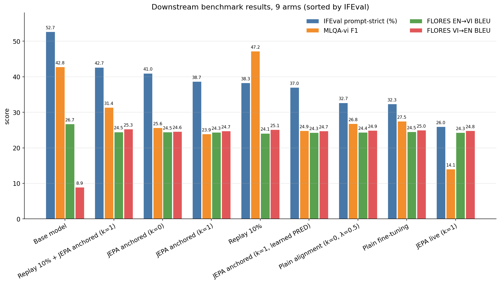
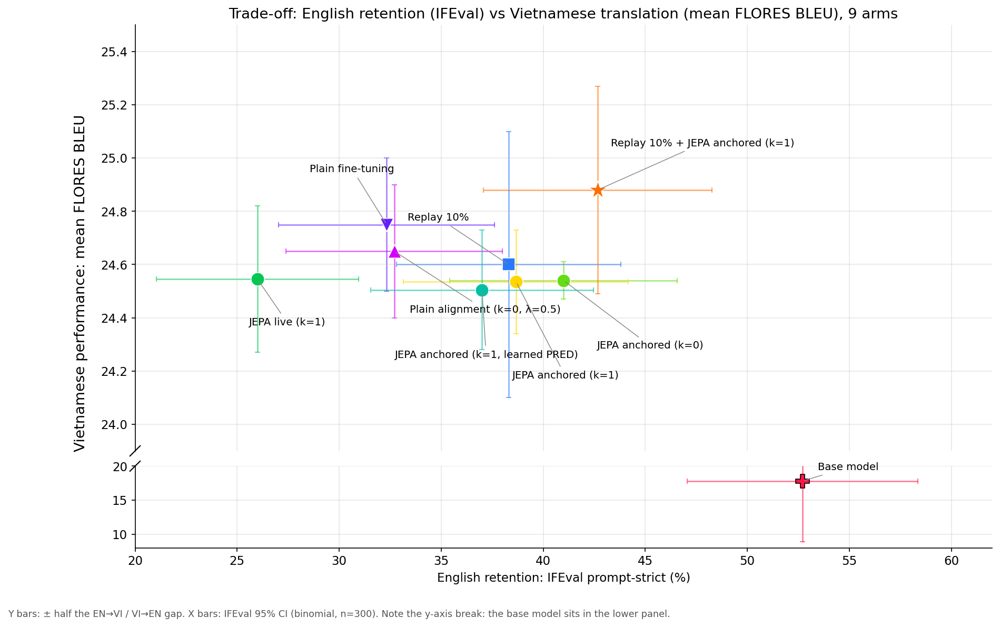
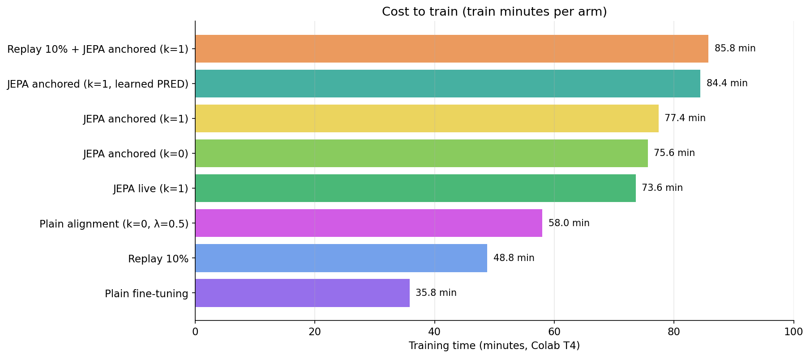
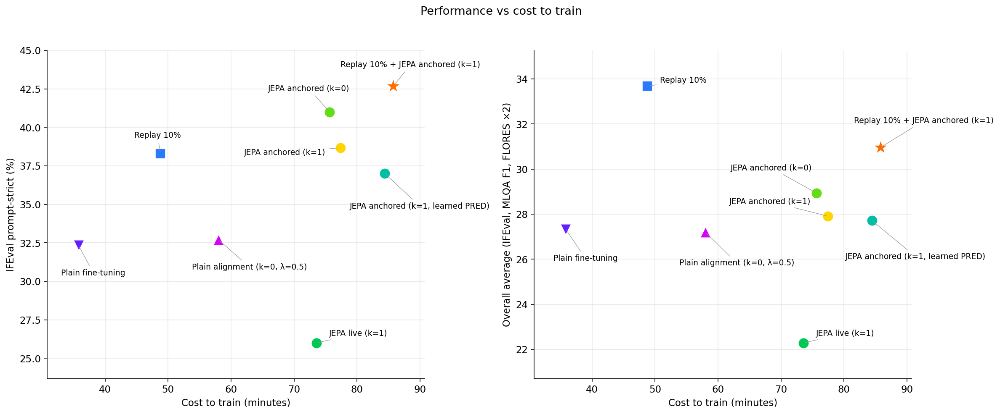
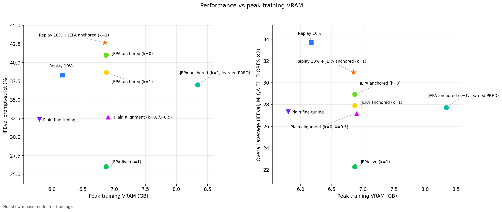

# Forgetting English While Learning Vietnamese

**Can a JEPA-style representation loss protect a small LLM's English abilities during language adaptation?**

We compared the base model and eight fine-tuned variants of `Llama-3.2-1B-Instruct` under one shared recipe to find out. This page covers what held up, what did not, and what we would test next.

[](https://colab.research.google.com/github/Tanay-s5/sift/blob/main/book.ipynb)

---

## Abstract

Adapting an instruction-tuned LLM to a new language usually costs it other abilities. The standard remedy, replaying general instruction data, needs data you may not have. Motivated by Aggarwal et al.'s work on continual fine-tuning for new languages, we asked whether an auxiliary **JEPA-style loss**, which pulls the model's representation of a Vietnamese sentence toward that of its English translation, can reduce forgetting without replay. We fine-tuned Llama-3.2-1B-Instruct with LoRA on 50k English-Vietnamese pairs under eight configurations (plain fine-tuning, alignment, JEPA with live or frozen targets, with and without a predictor token, and replay), alongside the untouched base model, and measured English instruction following (IFEval), Vietnamese QA (MLQA-vi) and translation (FLORES). Fine-tuning cost the model 20 IFEval points and 15 MLQA F1 points. Anchoring the English target to the frozen base model recovered about 9 IFEval points without hurting translation, while a live target collapsed. But 10% replay data did better on most measures and cost less, so in this setup it is the baseline. Hardware limitations restrict our experiments to a 1B-parameter model, with LoRA fine-tuning and a single seed across all runs.

## About this study

This is a small study with clear limits (see Section 7).

- They are compared on forgetting, translation quality, training time and memory.
- **Collapse diagnostics** were logged during training, which helped explain *why* one configuration failed rather than only that it did.
- The hypotheses are stated explicitly and checked against the evidence (Section 5), including the ones that did not hold up.

---

## 1. Motivation and hypotheses

When you fine-tune an instruction-tuned model on a narrow task, it tends to get worse at everything else (*catastrophic forgetting*). **Replay**, mixing general data back in, is the standard cure, but it assumes access to data that resembles the original training mix.

**Where this comes from.** This study was inspired by [Aggarwal et al. (arXiv:2410.16006)](https://arxiv.org/abs/2410.16006v1), who study how to teach an LLM new languages through continual fine-tuning without hurting what it already does well. They find that the model's original abilities deteriorate when the new-language data differs from what it was originally tuned on, and they mitigate this with generative replay and layer freezing. The extended version of that work traces the degradation to **representation shift**, a drift of the model's internal representations during fine-tuning (see Section 10). We took this representation shift as our starting point, if forgetting is representations drifting away from where the base model put them, then a loss that ties the new language's representations to the base model's might hold them in place. JEPA-style alignment is one way to do that, and this study tries it at a small scale. Replay is already known to help, so here it serves as a baseline rather than a hypothesis.

The alternative we wanted to test is adapted from [LLM-JEPA](https://arxiv.org/abs/2509.14252). A translation pair gives two views of the same meaning. If the model is asked to represent the Vietnamese sentence the way it already represents the English one, Vietnamese is pulled toward a region of representation space the model handles well, instead of the whole space being dragged around by the new task. In LLM-JEPA, however, the target is not frozen: both views are encoded by the same network that is being fine-tuned, so the target can drift along with the model. The strongest version, which we call anchored, takes the English target from the frozen original model, so the English side cannot drift.

The experiments are built to test these hypotheses:

| | Hypothesis |
|---|---|
| **H1** | Anchored alignment reduces forgetting *without* replay data. |
| **H2** | Alignment toward a *live* target is unstable. |
| **H3** | The predictor token (k=1) matters.|
| **H4** | Anchored alignment is competitive with replay. |

---

## 2. Experimental setup

| | |
|---|---|
| Model | `meta-llama/Llama-3.2-1B-Instruct` |
| Adapter | LoRA, r=16, alpha=32, on all 7 projections (q, k, v, o, gate, up, down), about 11.3M trainable parameters |
| Training data | 50,000 OPUS-100 en-vi pairs (Hugging Face Hub, shuffled with seed 42). Translation direction alternates, pairs over 256 tokens are dropped |
| Optimisation | effective batch 16, lr 2e-4, cosine schedule with 3% warmup, 3,124 steps, fp16 |
| Hardware | one Google Colab T4 |
| Seed | 42, one run per arm |

<br>

**Evaluation** 

| Benchmark | What it measures | Size | Metric |
|---|---|---|---|
| FLORES (en↔vi) | translation quality, both directions | 500 pairs | BLEU, chrF++ |
| MLQA-vi | Vietnamese reading comprehension | 500 questions | exact match, F1 |
| IFEval | English instruction following (our forgetting probe) | 300 prompts | prompt-level strict accuracy |


---

## 3. The nine arms

The training signal in every JEPA/alignment arm is

```
loss  =  γ · LM_loss  +  λ · ( 1 − cos( h_VI , h_EN ) )        γ = 1,  λ = 0.5
```

`h_VI` is the final-layer hidden state at the last token of the Vietnamese version (this side gets the gradient). `h_EN` is the same for the English version, with no gradient. With **k=1**, a special `[PRED]` token is appended to the Vietnamese view and the representation is read there. In the **anchored** arms, `h_EN` comes from the base model with the LoRA adapter switched off. In the **live** arms it comes from the model being trained.

| Arm | Extra loss | English target | `[PRED]` | Data |
|---|---|---|---|---|
| Base model | n/a | n/a | n/a | not trained |
| Plain fine-tuning | none | n/a | n/a | 50k OPUS |
| Plain alignment | alignment | live | none (k=0) | 50k OPUS |
| JEPA live | JEPA | live | k=1 | 50k OPUS |
| JEPA anchored (k=0) | JEPA | frozen base | none | 50k OPUS |
| JEPA anchored (k=1) | JEPA | frozen base | k=1 | 50k OPUS |
| JEPA anchored (k=1, learned PRED) | JEPA | frozen base | k=1, embedding is the mean embedding and trained | 50k OPUS |
| Replay 10% | none | n/a | n/a | 45k OPUS + 5k Alpaca |
| Replay 10% + JEPA anchored | JEPA | frozen base | k=1 | 45k OPUS + 5k Alpaca  |

---

## 4. Results

| Arm | IFEval | MLQA F1 | FLORES EN→VI | FLORES VI→EN | Overall avg | Train (min) | Peak VRAM (GB) |
|---|---|---|---|---|---|---|---|
| Base model | **52.7** | 42.8 | 26.7 | 8.9 | 32.8 | n/a | n/a |
| Plain fine-tuning | 32.3 | 27.5 | 24.5 | 25.0 | 27.3 | 35.8 | 5.8 |
| Plain alignment (k=0) | 32.7 | 26.8 | 24.4 | 24.9 | 27.2 | 58.0 | 6.9 |
| JEPA live (k=1) | 26.0 | 14.1 | 24.3 | 24.8 | 22.3 | 73.6 | 6.9 |
| JEPA anchored (k=0) | 41.0 | 25.6 | 24.5 | 24.6 | 28.9 | 75.6 | 6.9 |
| JEPA anchored (k=1) | 38.7 | 23.9 | 24.3 | 24.7 | 27.9 | 77.4 | 6.9 |
| JEPA anchored (k=1, learned PRED) | 37.0 | 24.9 | 24.3 | 24.7 | 27.7 | 84.4 | 8.3 |
| Replay 10% | 38.3 | **47.2** | 24.1 | 25.1 | **33.7** | 48.8 | 6.2 |
| Replay 10% + JEPA anchored | 42.7 | 31.4 | 24.5 | 25.3 | 31.0 | 85.8 | 6.9 |

*"Overall avg" is the mean of IFEval, MLQA F1 and the two FLORES BLEU scores. It is a crude summary that mixes scales, so we use it for orientation, not for ranking.*

### 4.1 Forgetting is real, and it is not only English


*Figure 1. Benchmark scores for every arm, sorted by IFEval.*

Three things stood out when we first laid these side by side.

**Every fine-tuned arm loses English instruction following.** Plain fine-tuning drops IFEval by 20 points, and no arm gets back to the base model's 52.7. Mitigation works, but only partly.

**Vietnamese forgets too.** Fine-tuning on translation drops MLQA-vi F1 from 42.8 to 27.5, a drop far outside the noise. Learning to translate does not teach the model to answer questions in Vietnamese. It seems to make it worse at it. Only the replay arm escapes (47.2), which suggests that a few instruction examples keep the model in "answer the question" mode.

**Translation barely differs between methods.** Every fine-tuned arm lands at about 24-25 BLEU in both directions.The whole gain is on VI→EN, where the base scores a low 8.9.

### 4.2 The trade-off: English retention vs Vietnamese quality


*Figure 2. English retention (x) against mean FLORES BLEU (y). Horizontal bars are IFEval 95% CIs, vertical bars are half the gap between the two translation directions. The y-axis is broken so the base model fits.*

If there were a real trade-off, arms would trade BLEU for IFEval along a diagonal. They do not. The vertical spread is under half a BLEU point, while the horizontal spread is 15+ IFEval points. In this setup **the arms differ in what they forget, not in what they learn**. For the anchored arms that means IFEval is bought without paying in translation.

### 4.3 Why the live target fails

JEPA live is the worst arm by a wide margin. We logged collapse diagnostics during training, and they show why:

| Arm | JEPA loss, first 100 steps → last 200 | Within-batch cosine of target vectors |
|---|---|---|
| JEPA live (k=1) | 0.25 → **0.011** | 0.77 → **0.95** |
| JEPA anchored (k=0) | 0.44 → 0.21 | 0.46 → 0.46 |
| JEPA anchored (k=1) | 0.44 → 0.21 | 0.46 → 0.46 |
| JEPA anchored (k=1, learned PRED) | 0.47 → 0.21 | 0.46 → 0.46 |

With a live target, the loss goes to almost zero, but not because the model learned something useful. The representations of *different* sentences became nearly identical (pairwise cosine 0.95, per-dimension spread near zero). This is **representation collapse**. When both sides of the loss move together, the best way to match them is to stop distinguishing inputs. The anchored target cannot move, so the loss settles near 0.21 and the representations stay diverse. A separate plain-alignment attempt at λ=1 also collapsed (IFEval 28.3, MLQA F1 11.7).

These results suggest that representation anchoring drives most of the gains, with limited benefit from the JEPA predictor. However, single-seed LoRA on a 1B model ia insufficient to rule out its potential benefits under full-parameter fine-tuning.<br>
anchored k=0 (41.0), k=1 (38.7) and k=1 with a learned PRED (37.0) are within noise of each other.

### 4.4 What it costs


*Figure 3. Training time per arm on a Colab T4. Times come from individual Colab sessions, so treat them as indicative.*


*Figure 4. IFEval (left) and overall average (right) against training time.*

JEPA-style losses need a second forward pass per batch, which roughly **doubles training time** (74-86 min against 36 for plain fine-tuning). Replay adds 13 minutes. In Figure 4, Replay 10% is alone in the corner of cheap *and* high. The anchored arms buy IFEval at about twice the cost and do not recover Vietnamese QA.


*Figure 5. IFEval (left) and overall average (right) against peak training memory.*

Everything fits on a T4, plain fine-tuning peaks at 5.8 GB, the JEPA arms at about 6.9 GB, and the learned-PRED arm at 8.3 GB.

---

## 5. Do the hypotheses hold?

| | Hypothesis | Evidence | Verdict |
|---|---|---|---|
| **H1** | Anchored alignment reduces forgetting without replay | IFEval 41.0 vs 32.3 (+8.7, just outside the ±7.7 band); MLQA unchanged (25.6 vs 27.5, within noise) | **Weak support**, a lead worth testing |
| **H2** | Live targets are unstable | JEPA loss falls to 0.011, target cosine rises to 0.95, IFEval 26.0, MLQA F1 14.1; the λ=1 attempt collapsed too | **Supported**  |
| **H3** | The predictor token matters | k=0: 41.0, k=1: 38.7, learned PRED: 37.0, all within noise; no benefit visible | **Not supported** in this setup |
| **H4** | Anchored alignment is competitive with replay | Replay 10% wins on overall average (33.7 vs 28.9), on MLQA (47.2 vs 25.6) and on cost (49 vs 76 min) | **Not supported** |

---

## 6. Discussion

Our reading of the evidence,

1. **Replay is the baseline to beat, and we did not beat it.** Ten percent general instructions gave the best overall score and the cheapest route to it. If replay data is available, the JEPA machinery is not competitive here.
2. **When replay data is not available, anchoring is the better alternative.** The anchored target keeps the English side of the representation fixed, and that is what separated the arms that held up from the one that collapsed. Anchored k=0 is essentially cross-lingual feature distillation toward the base model, so the JEPA framing may add little beyond that.
3. **Forgetting is wider than one benchmark.** An English-only forgetting probe would have missed the 15-point MLQA drop. Any future version of this study should measure forgetting on several fronts.
4. **Translation quality saturated.** On 50k OPUS pairs with a 1B model, all methods reached the same BLEU. That makes this a clean setting for studying forgetting, but it also means we cannot say anything about methods that would improve translation itself.

---

## 7. Threats to validity

- **One seed, one model size, one language pair.** We cannot say whether differences between close arms would survive reruns. Most IFEval gaps between arms are inside the noise band.
- **No confidence intervals on FLORES.** Differences under about 0.5 BLEU are noise.

- **Evaluation subsets are fixed**: The evaluation files are unchanged to ensure consistency across experiments. However, due to time and hardware constraints, we evaluated only a subset of the full benchmarks. These results should therefore be treated as indicators rather than definitive evaluation scores.
- **fp16 on a T4 is not bit-reproducible**, and wall-clock times vary between Colab sessions.

---

## 8. What we would do next

1. **Add seeds.** Two or more seeds for the arms would show how much of the ranking is noise.
2. **Tighten the IFEval comparison.** Use a paired bootstrap over the same prompts, and a larger prompt set if available.
3. **Test a missing arm.** A plain distillation baseline, to test whether the JEPA framing adds anything beyond anchoring.
4. **Sweep λ for the anchored arm**, since we only tried 0.5.

---

## 9. Reproduce it

1. Open the notebook in Colab with a **T4 GPU**.
2. Accept the [Llama-3.2 license](https://huggingface.co/meta-llama/Llama-3.2-1B-Instruct) and add your token to Colab Secrets as `HF_TOKEN`.
3. Run the four setup cells (packages, Drive + login + repo clone, `train.py`, `eval.py`).
4. Pick an arm: each has a train cell (36-86 min) and an eval cell (about 16 min). The base model has an eval cell only.

```
.
├── book.ipynb     # the whole experiment, runnable in Colab
├── eval/                          # frozen eval subsets
│   ├── flores.json                #   500 en-vi pairs
│   ├── mlqa_vi.jsonl              #   500 questions
│   └── ifeval.jsonl               #   300 prompts
├── figures/                       # the charts on this page
├── results/9_arms_data.csv        # every number behind the charts, with sources
└── README.md
```

---

## 10. Related work, credits, glossary

- Aggarwal, Damle, Goyal, Lokam and Sitaram, *Exploring Continual Fine-Tuning for Enhancing Language Ability in Large Language Model* ([arXiv:2410.16006](https://arxiv.org/abs/2410.16006v1)), **the paper that inspired this study**. It studies teaching an LLM new languages through two-phase continual fine-tuning, finds that existing abilities deteriorate when the new-language data is dissimilar to the original, and mitigates this with generative replay and layer freezing. Its extended version, *Exploring Two-Phase Continual Instruction Fine-tuning for Multilingual Adaptation in Large Language Models* ([Findings of ACL 2026](https://preview.aclanthology.org/ingest-acl/2026.findings-acl.1595/)), attributes the degradation to representation shift. We took inspiration from that framing and tried to address the same problem from a different angle: instead of replaying data or freezing layers, hold the representations in place with a JEPA-style anchoring loss. Our results suggest this works only partly (Section 4), and that replay remains the stronger baseline in our setup.
- Huang et al., *LLM-JEPA: Large Language Models Meet Joint Embedding Predictive Architectures* ([arXiv:2509.14252](https://arxiv.org/abs/2509.14252)), the source of the objective we adapted.
- Data and tools: OPUS-100, FLORES, MLQA, IFEval, `yahma/alpaca-cleaned`, sacrebleu, lm-evaluation-harness (IFEval scoring). Llama 3.2 is used under the Llama 3.2 Community License.

**Glossary**

- **LoRA**: fine-tune small low-rank adapter matrices instead of all weights.
- **JEPA**: Joint Embedding Predictive Architecture. Train a model to predict the *representation* of one view from another, rather than the raw tokens.
- **Anchored vs live target**: the English representation is computed by the frozen base model (anchored) or by the model being trained.
- **k**: how many `[PRED]` tokens are appended to the Vietnamese view (0 or 1 here).
- **IFEval**: checks whether a model obeys verifiable instructions such as "answer in under 100 words" or "use no commas".
- **BLEU / chrF++**: automatic translation-quality scores. **EM / F1**: exact-match and word-overlap scores for question answering.
